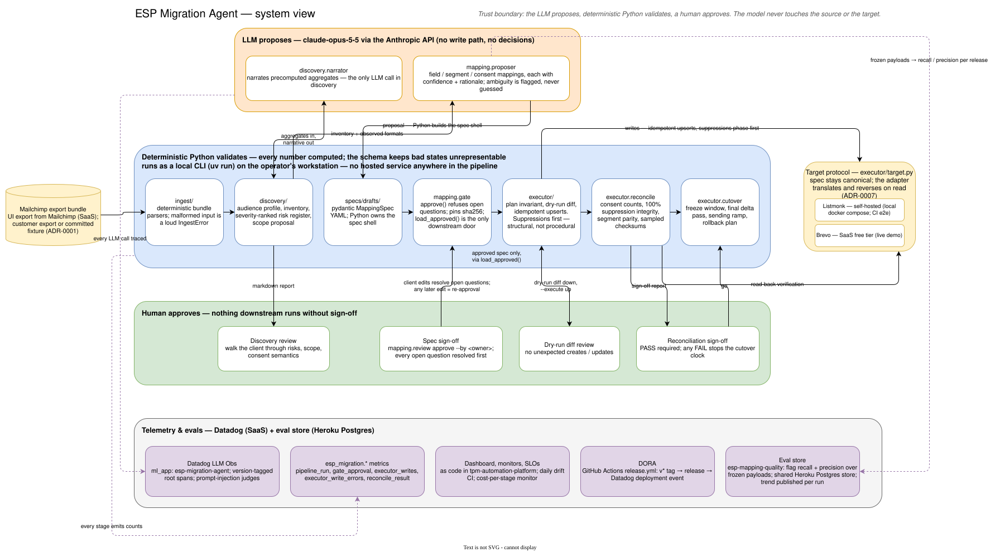

# ESP Migration Agent

Gated email-platform migration engine: upload a customer's export from one
email service provider, get a signed-off, validated migration into another.
The agent does the solutions-engineer work; a human approves each gate.

**Thesis: the LLM proposes, deterministic Python validates, a human approves.**



Running this on a real engagement: [docs/playbook.md](docs/playbook.md) is
the stage-by-stage FDE runbook (access, gates, acceptance criteria, rollback).

## Pipeline

1. **Ingest** - deterministic parsers over a real Mailchimp export bundle.
   Counting is not a judgment call; no LLM here.
2. **Discovery report** - what you have (lists, fields, segments, templates,
   suppressions, consent) plus an audience profile, a scope-and-estimate
   proposal, and a risk register. Every number computed; the LLM narrates.
3. **Mapping proposal** - field mappings, merge-tag translation, segment-logic
   translation, consent semantics. Every mapping carries a confidence and a
   rationale; ambiguous ones are flagged as open questions, never guessed.
4. **Human review gate** - the mapping spec is a reviewable document the
   customer edits and signs off. Nothing downstream runs from anything except
   the approved spec.
5. **Deterministic executor** - transforms per the approved spec, dry-run diff
   first, then loads the target via its API.
6. **Reconciliation report** - per-list counts, sampled checksums, suppression
   integrity, rolled into a customer-facing sign-off report.

**The hard rule, held in Python, never the model:** suppressions migrate
first, and no suppressed address can ever land subscribable in the target.
The schema cannot even represent a spec that violates it
(`specs/model.py::SuppressionPolicy`).

## Source and targets

The engine is ESP-agnostic by design: the mapping spec is canonical, and
platform differences live in adapters behind one protocol (ADR-0007), so a
new target is an adapter, not a rewrite. The platforms below are the worked
engagement, not the product's edges - today's source parsers cover
Mailchimp; Listmonk and Brevo already sit behind the same `--target` flag.

- Source: Mailchimp export bundle. The committed fixture is a genuine export
  of a free account seeded with Faker data - real format, synthetic data
  (ADR-0001).
- Dev target: self-hosted [Listmonk](https://listmonk.app). Live-demo target:
  Brevo free tier (ADR-0002).

## Layout

- `specs/` - mapping-spec schema (pydantic), worked example YAML (ADR-0003),
  and generated drafts under `specs/drafts/`
- `ingest/` - deterministic Mailchimp export-bundle parsers (ADR-0004)
- `discovery/` - audience profile, inventory, risk register, proposal, and
  the rendered report; the LLM only narrates computed aggregates
- `mapping/` - the LLM mapping proposer and the human review gate (ADR-0005);
  `mapping.gate.load_approved` is the only door downstream stages read through
- `review_ui/` - the review gate in the browser (ADR-0010): a React/Vite app
  over a thin FastAPI layer that wraps the gate - resolve flagged mappings,
  approve with a named owner, discovery charts alongside; never a bypass.
  Live demo at [esp.hihelloreid.com](https://esp.hihelloreid.com):
  fixture-seeded, fully browsable by anyone - including tripping the gate's
  verbatim refusal - while every write (resolving, signing off) is the
  approver's alone, explained by a demo-mode dialog (ADR-0011/0012)
- `executor/` - deterministic executor (ADR-0006/0007): plan builder with
  the suppression invariant, Listmonk + Brevo adapters behind one protocol
  (`--target`), dry-run diff, idempotent execution, reconciliation report,
  cutover plan
- `scripts/demo.sh` - the scripted end-to-end demo (runbook: docs/demo.md)
- `seeding/` - deterministic subscriber generator + Mailchimp seeder, and the
  `ground_truth.json` the discovery stage is verified against
- `fixtures/` - the synthetic export bundle (see fixtures/README.md)
- `docs/architecture.drawio` - the system view as editable draw.io source;
  `docs/architecture.svg` is its committed export
- `docs/playbook.md` - the FDE migration runbook, stage by stage
- `docs/engagement.md` - the reference engagement written up as a real
  SOW + acceptance report, every figure traced to a committed artifact
- `docs/discovery_report.html` - the discovery report as one self-contained
  HTML file (audience-profile charts, risk register, proposal; RC1-559) -
  the render an FDE sends the client; `--html` regenerates it
- `docs/decisions.md` - ADRs, newest first

## Commands

```bash
uv sync                                       # install
uv run ruff check . && uv run pytest          # checks (same as CI)
uv run python -m seeding.mailchimp_seeder --dry-run   # regenerate ground truth
uv run python -m discovery.report [--narrate] [--spec SPEC.yaml] [--html report.html]  # stage 2
uv run python -m mapping.review propose       # stage 3 (draft spec)
uv run python -m mapping.review status SPEC.yaml      # stage 4 (review)
uv run python -m mapping.review approve SPEC.yaml --by "Name"
uv run python -m review_ui                    # stage 4 in the browser (:8542)
uv run python -m executor.run --spec specs/approved/SPEC.yaml   # stage 5 dry-run
uv run python -m executor.run --spec ... --execute              # stage 5 write
uv run python -m executor.reconcile --spec ...                  # stage 6
uv run python -m executor.cutover --spec ... --out docs/cutover_plan.md
```

The review UI needs the `ui` group (`uv sync --group ui`). Dev is two
processes: the backend above, plus `npm run dev` in `review_ui/frontend`
(the Vite server proxies `/api`). After `npm run build`, the backend serves
the built app alone.

End-to-end against a real target: `docker compose up -d`, then
`eval "$(uv run python -m executor.bootstrap --export)"`, then
`uv run pytest -m integration`.

Work is tracked under Jira epic RC1-542 (scaffold: RC1-543; ingest +
discovery: RC1-544; mapping + review gate: RC1-545; executor +
reconciliation: RC1-546).
